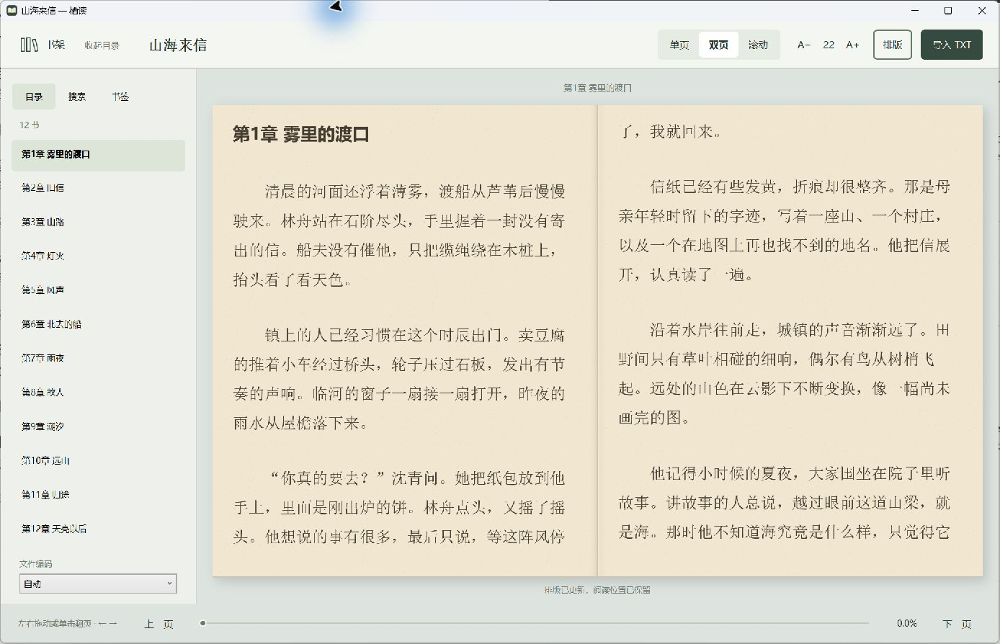
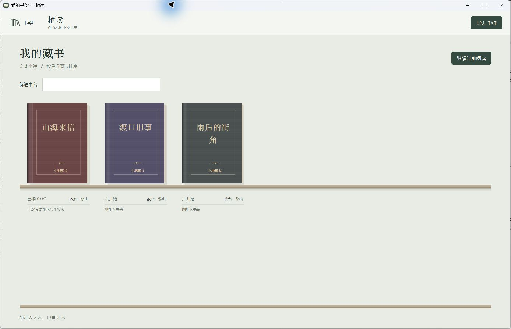

<p align="center"></p>

# 栖读 · Qidu

面向 Windows 的离线中文 TXT 小说阅读器。打开本地小说，放进书架，按自己习惯用单页、双页或滚动阅读。

**当前版本 0.1.9 · Windows 11 x64 · MIT 开源许可**

**[下载 Windows 安装版](https://github.com/Ray0766/qidu-reader/releases/download/v0.1.9/TXT-Reader-0.1.9-Setup-x64.exe)** · [便携 ZIP](https://github.com/Ray0766/qidu-reader/releases/download/v0.1.9/TxtReader-0.1.9-win-x64.zip) · [所有版本](https://github.com/Ray0766/qidu-reader/releases)

开发分支正在准备 **0.2.0 预览**：新增 EPUB 2/3 图文阅读、Windows 7 SP1／8.1 兼容构建，以及苹果 M 系列 Mac 界面。它们不是上面 0.1.9 安装包已有的功能；Mac 最低目标为 macOS 15，旧 Windows 的实机验证仍待完成。范围与验证状态见 [跨平台预览说明](docs/portability-preview.md)。

Microsoft Store 申请已于 2026-10-25 提交认证，正式商店下载尚待上架后验证。



## 下载与安装

普通用户下载上面的安装版或便携包，无需安装 .NET、SDK、Git 或 Visual Studio，也不用编译源码。

| 文件 | 用途 |
| --- | --- |
| `TXT-Reader-0.1.9-Setup-x64.exe` | 双击安装，从桌面或开始菜单打开“栖读” |
| `TxtReader-0.1.9-win-x64.zip` | 解压后运行 `TxtReader.exe`，保留整个文件夹 |
| GitHub 的 `Source code` | 源码，面向开发者；日常使用请下载上面两种包 |

安装包自带运行环境，按当前用户安装，无需管理员权限。安装时可选桌面快捷方式。升级直装版时先关闭阅读器，再运行新版安装包；卸载程序保留书库。

当前自制 EXE 未做代码签名，互联网下载后可能显示未知发布者或 SmartScreen 信誉提示。商店版本审核通过后由 Microsoft Store 签名和分发；GitHub 直装包不会因此自动获得签名。正式分发路线和更新方式见 [Windows 发布说明](docs/windows-distribution.md)。

## 阅读功能

- **书本式书架**：多选导入 TXT、拖入文件、按书名筛选、改名和移出；按内容去重。
- **单页／双页／滚动**：随时切换，重排后继续看同一段原文。按识别出的章节另起新页。
- **自然翻页**：正文左右半区点击、左右键、PgUp/PgDn、空格和滚轮；正文任意位置按住左右拖动，纸页跟手弯曲，松手完成或回弹。
- **可调整的排版**：多种字体，14–36 字号，柔白、米色、护眼绿、雾蓝、夜读、纸张质感；窄、标准、宽、铺满四种正文宽度。
- **目录跟随**：自动高亮当前章并滚入可见范围，侧栏可收起。
- **全文搜索**：每批 200 条，前后翻批；高亮原文，支持返回搜索前的位置。
- **书签与续读**：每本书独立保存书签和原文位置；关闭重开恢复阅读模式、字号及外观偏好。
- **本地使用**：不联网获取小说，不需要账号；附带自有排版示例。



| 快捷键 | 功能 |
| --- | --- |
| Ctrl+O / Ctrl+F / Ctrl+D | 导入 / 搜索 / 添加书签 |
| Ctrl+B | 显示或收起侧栏 |
| ← / →、PgUp / PgDn | 上一页／下一页（双页时翻一组） |
| F11 / Esc | 全屏；Esc 优先取消拖页，再退出全屏 |

未完成的拖页不会保存为新位置；按 Esc、切换应用、最小化、改变模式或字号会取消尚未落定的拖页。搜索框中的方向键用于编辑文本。关闭动画后仍可拖动翻页。

## 书库与升级

0.1.9 的书库保存在 `%USERPROFILE%\QiduLibrary`，其中 `books` 是导入的副本，`reading.db` 保存书架、书签、阅读位置和设置。便携包也使用这个用户书库，并非随程序文件夹携带数据。

旧试用版使用 `%LOCALAPPDATA%\TxtReaderPreview`。新版直装／便携程序首次启动会复制、校验旧库并保留原目录；已有新库时以新库为准。MSIX 可能无法直接读取旧版 AppData：可先用新版直装程序迁移，再由商店版接续，也可重新导入 TXT。

不要同时打开新旧版本分别保存进度。备份时先正常关闭阅读器，再复制完整的 `QiduLibrary` 文件夹。移出书架会保留本机副本及历史数据，重新导入相同内容可恢复；卸载也不会删除独立书库。

## 支持范围

自动识别严格 UTF-8、带 BOM 的 UTF-16 和 GB18030；可手动选择 UTF-8、GB18030、GBK、Big5、UTF-16、UTF-16BE。Big5 或不带 BOM 的 UTF-16 请手动选编码。

单文件上限 150 MiB，完整文本仍载入内存、排版分段加载。双页遇到内容分段末尾可能有一页空白，继续翻页即可接着读。“位置保留”保证同一原文锚点仍可见，页码和页边界随排版变化。章节起页依赖标题识别。

已发布的 0.1.9 面向 Windows 11 x64。Mac 与旧 Windows 的新增工作见上方预览说明；Linux、Windows ARM64 和手机版尚未提供。备份恢复界面、手动封面图片导入、云同步和直装版自动更新尚未实现。纸页动效是曲面视觉近似；软件渲染设备和系统动画设置会影响效果。

0.1.9 已通过 1,199 项阅读回归、独立 MSIX 升级／卸载重装、干净 Windows 安装以及日常旧库迁移验证。详细范围与限制见 [验证说明](docs/validation.md)。

## 开发

C# · .NET 10 · WPF · SQLite。开发需要 Windows、PowerShell 7 和 `global.json` 指定的 .NET SDK 10.0.402。

```powershell
.\scripts\build.ps1
.\scripts\verify.ps1
.\scripts\build.ps1 -Publish
```

构建与安装包命令、测试约定和目录结构见 [参与开发](CONTRIBUTING.md)。[移动阅读应用调研](docs/mobile-reader-app-research.md)、[拖动翻页规格](docs/page-corner-drag-spec.md) 保留了交互取舍依据。

## 许可

本项目采用 [MIT 许可证](LICENSE)。第三方运行时和依赖遵循各自许可，见 [third-party](third-party/README.txt)。图标与示例由项目自有，不包含用户导入的小说、私人书库或账号资料。
