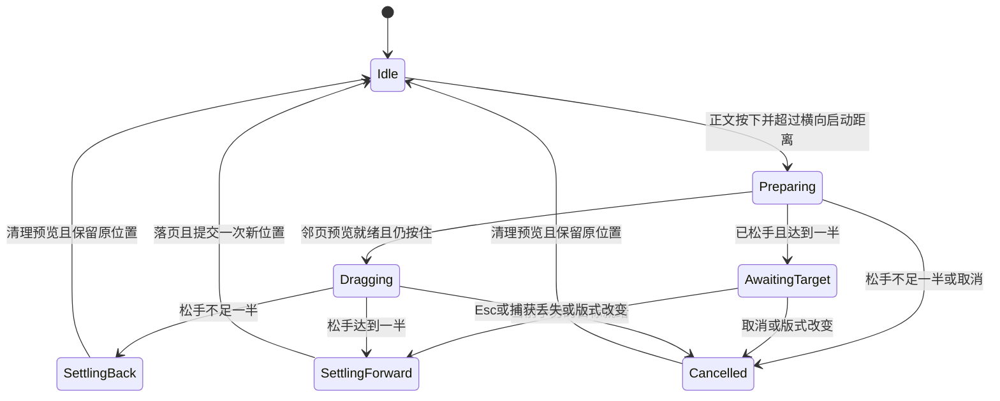

# 正文与页角拖动翻页交互与验收规格

日期：2026-10-25。0.1.4 扩展为正文任意位置拖动，本页下述规则沿用至当前版本。0.1.2 仅支持页角，0.1.3 增加整页单击；最新验收范围见 [发布验证说明](validation.md)。依托原文锚点、单／双页排版和纸页视觉层实现。相关产品依据见 [移动阅读应用调研](mobile-reader-app-research.md)。

目标是让鼠标真正控制纸页：可慢拖、停留、回拖，松手按当时距离完成翻页或回弹。任何未完成的翻页均不改变阅读进度、书签位置或重开后的续读位置。

## 可操作范围

单页和双页分页模式均支持。正文任意位置按住左键，向左拖为下一页（组），向右拖为上一页（组），不由按下位置所在的半边决定。双页阅读方向仍为先左后右，一次翻过一组。滚动模式不拦截拖拽作为翻页。

按下先进入待判定状态，水平位移达到 6 DIP 且不小于垂直位移时锁定方向并开始拖动。纵向移动不直接启动翻页。外侧页角仍保留轻微卷角提示，正文全区均可操作，底栏说明左右拖动；正文区域不增加常驻装饰。

0.1.3 用户追加：普通翻页覆盖整张正文，任意高度单击左半边上一页、右半边下一页；页角轻点同样翻页。按住后曾移动达到 6 DIP，就不再按单击处理，避免回拖误翻。取消、失焦或重排会清除待处理的单击，迟到的松手不会翻页。←/→、PgUp/PgDn 均支持；目录、书签获得焦点后左右键仍可翻页，搜索输入框保留光标操作。

DIP 为 WPF 使用的逻辑像素，热区不按显示器物理像素写死。上下角的斜向弯曲要镜像对应，书脊保持在原位。

## 拖动与松手判定

| 参数 | 初始规则 |
| --- | --- |
| 单页宽度 | 记作 W；双页总宽约为 2W |
| 完成距离 D | clamp(0.35 × W, 60, 180) DIP，不随正文按下点改变 |
| 拖动进度 p | 朝锁定方向的水平位移 / (2D)，限制在 0 到 1 |
| 松手完成 | p ≥ 0.5，即最终水平位移达到 D；不再以书缝或屏幕中线作为阈值 |
| 松手回弹 | p < 0.5；以松手时位置判断，不取曾经到达的最大距离 |
| 垂直位移 | 改变折线方向、卷曲形状与投影，不单独增加完成进度 |
| 速度 | 第一版不使用快速甩动覆盖距离规则，保持行为可预测 |
| 落页时间 | 初始目标 180–320 ms，随剩余行程变化；起点必须是松手瞬间的形状 |

这些数值是本项目可调默认值，不是对竞品参数的测量结果。判定从鼠标按下位置计算，避免在热区内不同位置按下就突然折起一截纸页。

鼠标移动时实时更新曲面，不能把拖动仅映射为固定动画的播放速度。正文按下点驱动同一高度的纸张外缘，保留按下位置到外缘的横向偏移，初始不跳向某个角。外缘随水平和垂直位移弯曲，使用书脊两端距离约束防止纸张拉伸。这是圆柱曲面视觉近似，不是对正文某一点做完整纸张物理模拟。暂停时保持曲面，拉回时连续展开；越过按下点则展开回零，不反向提交另一页。

## 内容与位置保持

双页向前翻时，旧左页和新右页作为底层，旧右页为活动纸张正面，新左页为纸背；向后翻时镜像处理。书尾仅有一页、章节边界或排版分段末尾也必须取实际内容，不能为了补齐视觉而重复或跳过一页。

拖动期间，公开读取的 Anchor、底部百分比、自动保存和新增书签都以已提交位置为准。候选页、候选分段和候选锚点仅存在于预览状态。完成落页后一次性提交目标并通知位置变化；回弹或取消不发送新的阅读位置。

邻页准备期间记录最新鼠标位置。若先松手，仍按释放时的距离判定：不足一半立即取消，达到一半则在同一次手势的目标就绪后完成；等待期间仍允许 Esc 或新导航操作取消。主动释放鼠标捕获是正常松手流程，不能误判成外部捕获丢失。任何取消都丢弃迟到的准备结果，准备失败则保留原位置并提示。

预览必须隔离书籍、手势与排版状态，切书、改字号或改窗口后不得显示旧预览。0.1.2 使用手势对象身份校验；所有相关变更先使对象失效，再通过操作队列重排，效果等价于递增版本校验。WPF 分页仍在 UI 线程进行，但只准备当前或邻接的有界正文分段，不对整个大文件重新分页。

## 与其他操作的关系

- Esc 优先取消正在拖动的书页，再处理全屏退出。
- 拖动中失去鼠标捕获、切换应用、最小化或窗口关闭均取消预览；关闭时保存原已提交位置。
- 拖动中变更字体、字号、宽度、侧栏、窗口尺寸或 DPI：先取消，再按原文锚点重排。
- 搜索、目录、书签跳转及切书：先取消，再执行目标操作，不能让迟到的翻页完成覆盖跳转。
- 拖动中到来的滚轮与连续翻页按键不积压为后续多次翻页；本次手势结束后再接受新翻页输入。
- 首尾边界可以按下以判定手势方向，但不可翻的方向不创建预览或提交进度，松手释放捕获。
- 关闭动效时仍可用距离判定的拖动操作，但用简明预览替代三维卷曲，松手直接到结果；其他翻页方式继续沿用原设置。

## 已实现的代码入口

[ReaderSurface](../src/TxtReader.App/ReaderSurface.cs) 的 TurnAsync 保留明确完成的按钮翻页流程；可取消的拖拽由 [ReaderSurface.Drag](../src/TxtReader.App/ReaderSurface.Drag.cs) 管理，不提前更新 `_anchor`。

手势拆为“准备候选页、预览、提交或取消”。候选文档、分页器、原文映射与锚点独立保存；跨分段时在旧页面后方排版并截图，当前阅读视窗不变。落页之后同步替换候选状态，并仅通知一次位置变化。取消会丢弃候选文档及迟到结果。

[PageTurnLayer](../src/TxtReader.App/PageTurnLayer.cs) 提供 BeginDrag、UpdateDrag、SettleDragAsync 和 Cancel；保留自动翻页的 PlayAsync。[PaperCurl](../src/TxtReader.App/PaperCurl.cs) 根据二维抓取点生成圆柱弯曲，约束两端书脊并计算纸背投影。视觉层不持有正式阅读位置；鼠标在原生阅读表面捕获，动画层不接收输入。

预览纹理在一次手势开始时准备，鼠标移动仅更新几何与阴影，避免每次移动重新截图或分页。保留当前硬件降级策略。每帧合并多次鼠标移动，以最新点更新，避免事件队列累积造成明显追赶。

## 验收用例

| 场景 | 必须看到或断言的结果 |
| --- | --- |
| 双页四角，单页四角 | 方向正确，上下角的弯曲随抓取位置变化；内容正反面正确 |
| 正文上／中／下、左右两半、书缝附近 | 每个位置均可向左或向右发起；相同距离门槛，单击和拖动互不误判 |
| 慢拖 10%、40%、60%，各停留一秒 | 纸页固定在对应位置，不自行继续播放；拖动中 Anchor 和保存值不变 |
| 40% 松手 | 连续回弹；当前正文、锚点、百分比和重开位置全部保持 |
| 60% 松手 | 连续落页，只提交一次；与同模式一次按钮翻页到达的原文范围相同 |
| 80% 后退回 20% 再松手 | 回弹；不能因曾经超过阈值而完成翻页 |
| 邻页未准备好就松手 | 40% 取消，60% 待目标就绪后只完成一次；期间 Esc 或切书会使旧结果失效 |
| 斜拖、拖回角点、越出阅读区 | 无曲面翻转、书脊漂移、文字镜像错误或捕获残留 |
| Esc、Alt+Tab、最小化、关闭 | 不误提交；恢复或重开后可正常操作 |
| 拖动中改字号、模式、宽度或目录显示 | 取消后原锚点在新布局中可见，无旧帧覆盖新正文 |
| 拖动中搜索跳转或切书 | 目标操作生效，迟到的旧预览不能回写位置 |
| 连续正反拖拽至少 50 次 | 不多翻、不吞掉已完成操作、不遗留动画；再切滚动可继续原文 |
| 书首、书尾、章首、跨内容分段 | 无重复／漏字；没有上一页或下一页时不可触发该方向 |
| 系统关闭动画或软件渲染 | 降级后仍能正确完成／取消，正文清晰可读 |
| 100%、150%、200% DPI，调整窗口大小 | 热区尺寸合理，曲面与正文对齐；需分别记录实测范围 |

用自有示例和本机真实长篇分别检查。重跑既有阅读位置与分段连续性回归，并新增拖拽状态测试。视觉验收需包含按住停留、松手回弹、正反向落页的录屏或连续帧；仅验证最终页码不算通过。

性能记录区分邻页准备耗时、落页耗时和曲面更新的 CPU 耗时。CPU 几何更新耗时不等同于完整 GPU 帧时间，不能据此宣称稳定 60 FPS。窗口实际缩放与硬件渲染级别在报告中记录；未实测的 DPI 或设备不计为通过。
